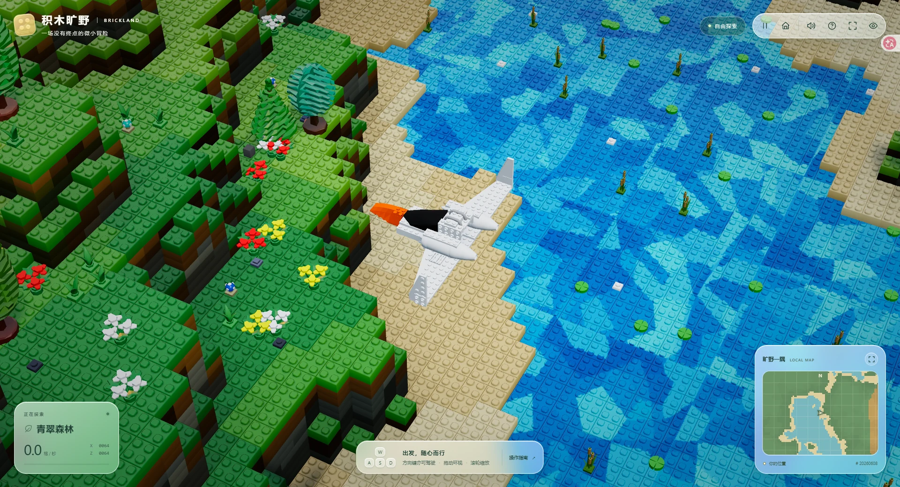
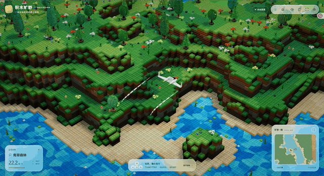
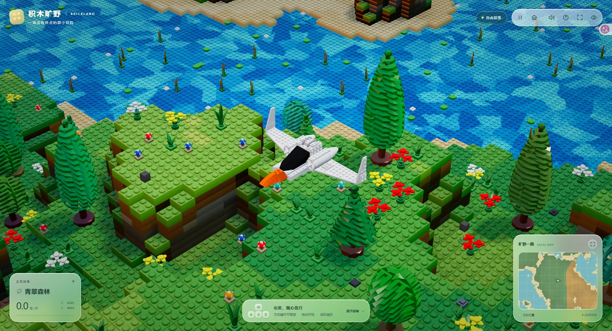
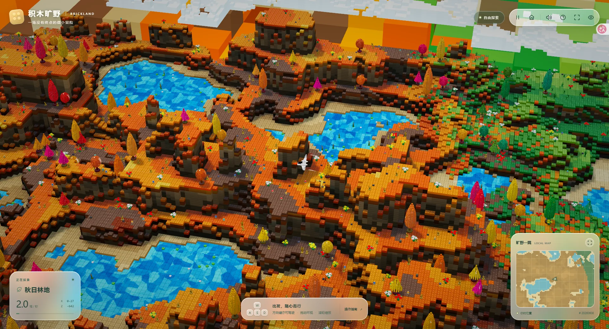
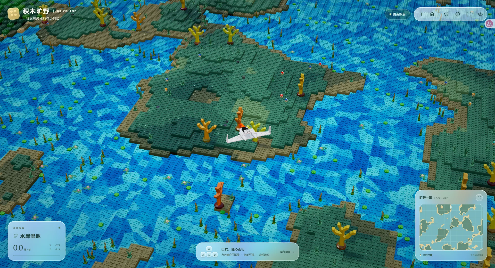
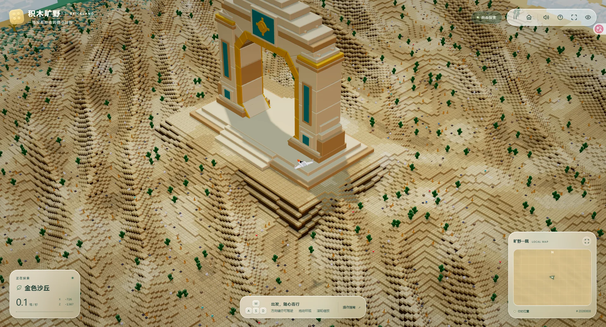
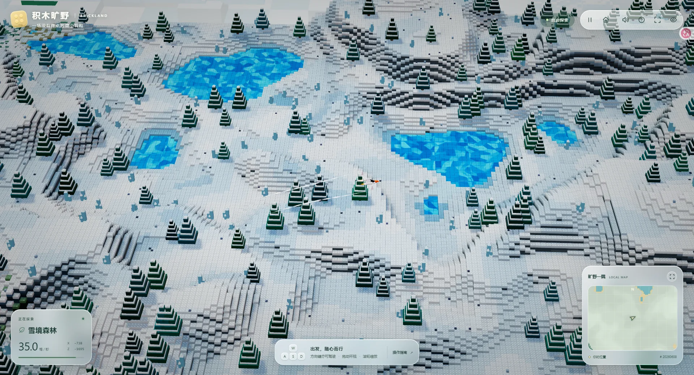
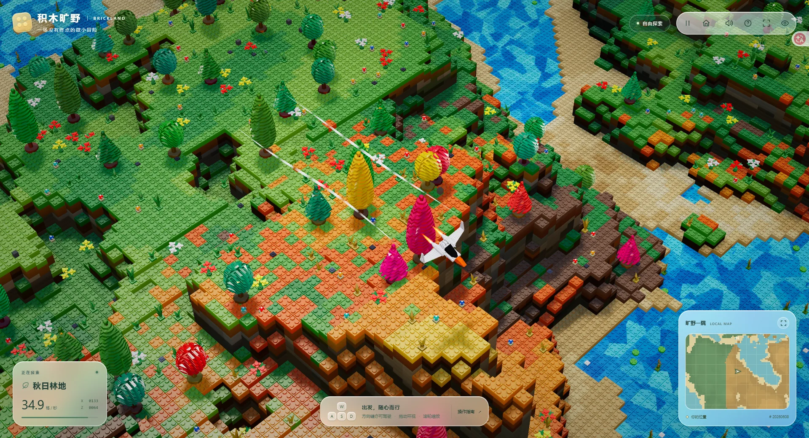

# 积木旷野 · BRICKLAND

一场没有终点的微小冒险。驾驶积木飞机，探索由程序生成的森林、河流、沙丘与雪境。

A little adventure with no finish line. Fly a brick-built plane through a procedural world of forests, rivers, dunes, and snow.

[](https://lego-stylized-nature.vercel.app/)

**[进入旷野 · Explore live ↗](https://lego-stylized-nature.vercel.app/)** · [观看实机录像 · Watch the flight](docs/readmeImg/optimized/flight-demo.mp4)

## 随心飞行 · Take flight

掠过树梢，沿着河流转弯，让好奇心决定下一站。

Skim the treetops, follow a bend in the river, and let curiosity choose your next stop.

[](docs/readmeImg/optimized/flight-demo.mp4)

*5 秒循环预览；点击查看完整的 7 秒录像。 / A 5-second loop; click for the full 7-second recording.*

## 旷野掠影 · World gallery

从青翠河岸到覆雪山丘，每一片风景都有自己的颜色。

From green riverbanks to snow-covered hills, every landscape has its own palette.

<table>
  <tr>
    <td width="50%">
      
      <br><strong>青翠森林 · Verdant forest</strong>
      <br>树影、繁花与层层叠起的河岸。
      <br>Leafy canopies, small flowers, and terraced riverbanks.
    </td>
    <td width="50%">
      
      <br><strong>秋日林地 · Autumn woodland</strong>
      <br>橙黄树冠之间，河流穿过暖色山谷。
      <br>Blue rivers wind through valleys of warm autumn color.
    </td>
  </tr>
  <tr>
    <td width="50%">
      
      <br><strong>水岸湿地 · Waterside wetlands</strong>
      <br>零散小岛与水生植物点缀开阔水面。
      <br>Small islands and aquatic plants dot the open water.
    </td>
    <td width="50%">
      
      <br><strong>金色沙丘 · Golden dunes</strong>
      <br>起伏沙丘之间，一座拱门等待被发现。
      <br>A monumental arch waits among the rolling dunes.
    </td>
  </tr>
  <tr>
    <td width="50%">
      
      <br><strong>雪境森林 · Snowy forest</strong>
      <br>白色山丘与针叶林环抱着湛蓝湖泊。
      <br>White hills and evergreen trees surround vivid blue lakes.
    </td>
    <td width="50%">
      
      <br><strong>转弯之间 · On the wing</strong>
      <br>倾斜机翼，在林间留下一道飞行轨迹。
      <br>Bank over the trees with trails following the wingtips.
    </td>
  </tr>
</table>

## 关于作品 · About

积木旷野是一个运行在浏览器中的积木风格自然探索作品：把微缩景观的趣味，放进一片可以自由飞行的世界。

BRICKLAND is a browser-based, brick-styled nature exploration project, bringing the charm of a miniature landscape into a world you can fly through.

- **七种自然风貌 · Seven biomes** — 青翠森林、秋日林地、金色沙丘、熔岩山谷、雪境森林、繁花草甸与水岸湿地。 / Forests, autumn woodlands, deserts, volcanic valleys, snowy forests, flower meadows, and wetlands.
- **沿途展开的世界 · A world that unfolds** — 基于种子的程序化地形，随着飞行分块生成与加载。 / Seed-based procedural terrain, generated and loaded in chunks as you explore.
- **看得见的积木质感 · Brick-built detail** — 层叠地形、积木凸点、植被、水面，以及飞机转弯时的姿态与翼尖气流。 / Layered terrain, studs, vegetation, water, and a plane that banks into turns with wingtip trails.

## 操作指南 · Controls

推荐使用支持 WebGPU 的新版桌面浏览器，并开启硬件加速。

For the best experience, use a recent desktop browser with WebGPU support and hardware acceleration enabled.

| 按键 / Input | 操作 | Action |
| --- | --- | --- |
| `W` / `↑` | 向前飞行 | Forward thrust |
| `S` / `↓` | 反向推进 | Reverse thrust |
| `A` `D` / `←` `→` | 左右转向 | Turn left / right |
| 鼠标拖动 / Mouse drag | 环视 | Orbit the camera |
| 滚轮 / Scroll wheel | 缩放 | Zoom |
| `Space` | 暂停 / 继续飞行 | Pause / resume flight |
| `H` | 隐藏 / 显示界面 | Hide / show the HUD |
| `M` | 静音 / 开启声音 | Toggle sound |
| 小地图右上角 / Map expand button | 展开 / 收起地图 | Expand / collapse the map |
| `Esc` | 收起已展开的地图 | Collapse the expanded map |

顶部工具栏可返回出生点、切换全屏或查看帮助；触屏设备也可使用屏幕方向按钮驾驶。

Use the top toolbar to return to the starting point, toggle fullscreen, or open help. Touch devices also have on-screen flight controls.

## 本地运行 · Run locally

安装 [Node.js](https://nodejs.org/)（推荐 22 LTS 或更新版本）和 [pnpm](https://pnpm.io/installation)，在项目目录运行：

Install [Node.js](https://nodejs.org/) (22 LTS or newer recommended) and [pnpm](https://pnpm.io/installation), then run from the project directory:

```sh
pnpm install --frozen-lockfile
pnpm dev
```

打开终端显示的本地地址。开发时在地址末尾添加 `#debug`，可打开调试面板。

Open the local URL printed in the terminal. Append `#debug` during development to open the debug panel.

```sh
# 运行测试 / Run tests
pnpm test

# 构建到 dist/ / Build to dist/
pnpm build
```

## 幕后技术与致谢 · Under the hood & acknowledgements

基于 **Three.js · WebGPU · TSL · Vite** 构建，使用 **simplex-noise** 生成噪声、**Tweakpane** 调整开发参数。地形分块与 Web Workers、实例化渲染和自定义着色共同支撑这片积木世界。

Built with **Three.js · WebGPU · TSL · Vite**, with **simplex-noise** for procedural noise and **Tweakpane** for development controls. Terrain chunks, Web Workers, instanced rendering, and custom shading bring the brick-built world to life.

项目从 Three.js TSL 学习模板起步，感谢开源工具与学习资源：

The project grew from a Three.js TSL learning template. Thanks to the open-source tools and learning resources behind it:

特别感谢 [Three.js Journey](https://threejs-journey.com/) 和 [Bruno Simon](https://bruno-simon.com/)，为这个项目提供了学习指引与创作灵感。

Special thanks to [Three.js Journey](https://threejs-journey.com/) and [Bruno Simon](https://bruno-simon.com/) for the learning resources and creative inspiration behind this project.

- [Three.js](https://threejs.org/) · [Three.js Shading Language](https://github.com/mrdoob/three.js/wiki/Three.js-Shading-Language)
- [Three.js WebGPU examples](https://threejs.org/examples/?q=webgpu) · [TSL textures](https://github.com/boytchev/tsl-textures)
- [Vite](https://vite.dev/) · [Tweakpane](https://tweakpane.github.io/docs/) · [simplex-noise](https://github.com/jwagner/simplex-noise.js)

更多实现笔记见 [`docs/`](docs/)。 / More implementation notes live in [`docs/`](docs/).
